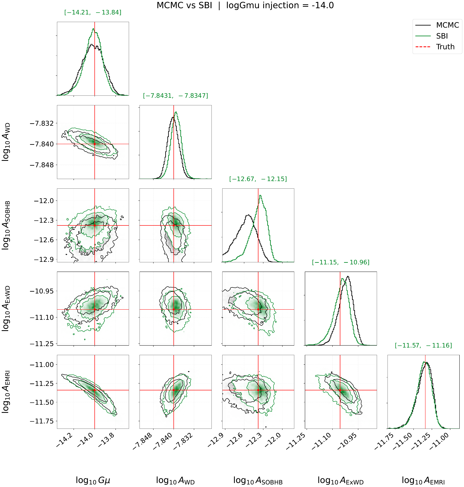
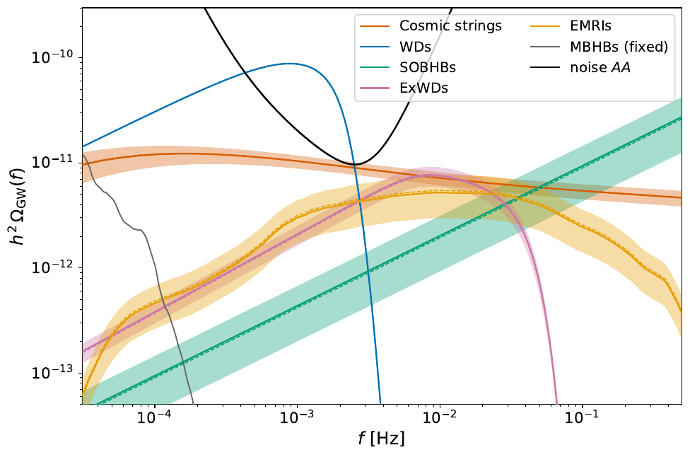
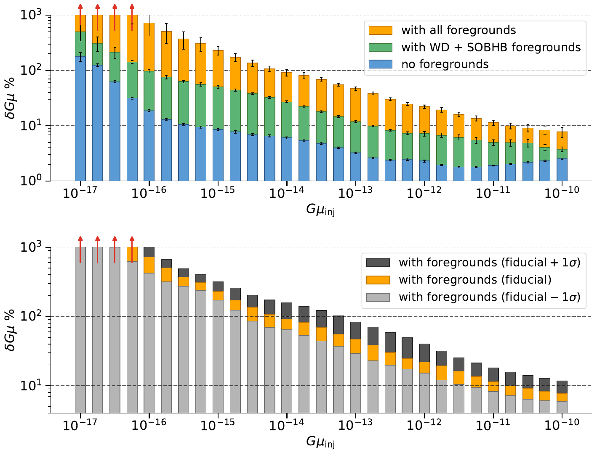
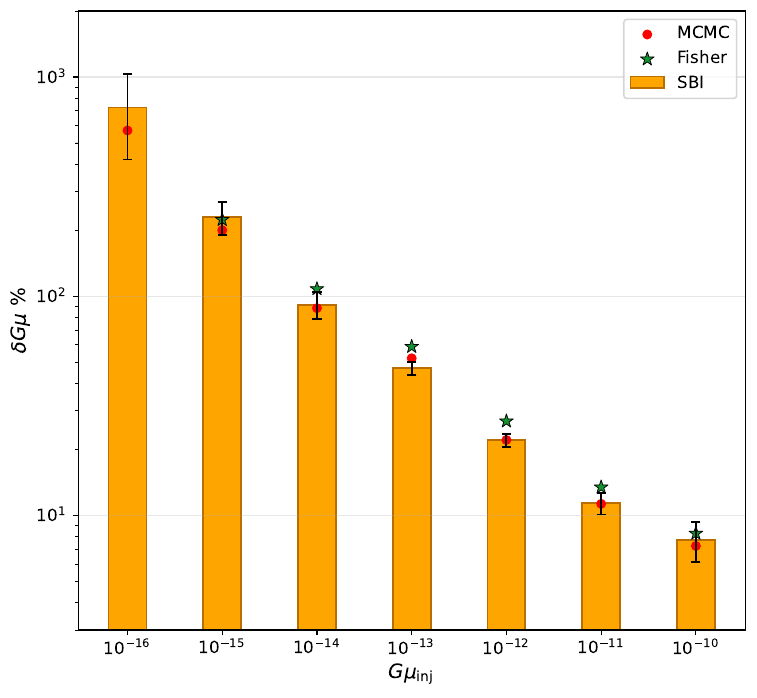

# GWBackFinder-foregrounds

Measuring the cosmic-string tension Gμ with LISA in the presence of astrophysical foregrounds.

This package is the companion of [GWBackFinder](https://github.com/AndronikiDimitriou/GWBackFinder)
([arXiv:2309.08430](https://arxiv.org/abs/2309.08430)). The two use different methods:

|  | GWBackFinder | GWBackFinder-foregrounds |
|---|---|---|
| Signal model | model-independent: 26-slope piecewise power law | parametric: cosmic strings (BOS) with tension Gμ |
| Foregrounds | — | Galactic WDs, SOBHBs, extragalactic WDs, EMRIs (inferred), MBHBs (fixed) |
| Posterior | two conditional networks: TT (noise), then AA given noise | one joint network over all parameters, AA + EE + TT |
| LISA response | analytic | exact tabulated response |
| Cross-checks | — | MCMC (emcee) and Fisher matrix |

## Install

```bash
git clone https://github.com/AndronikiDimitriou/GWBackFinder-foregrounds.git
cd GWBackFinder-foregrounds
pip install -e ".[all]"     # numpy, scipy, jax, torch, sbi 0.25, emcee, corner, pytest
pytest                      # ~30 s
```

The trained posteriors (~230 MB each) are too large for git. They are attached to the
[`posteriors-v1` release](https://github.com/AndronikiDimitriou/GWBackFinder-foregrounds/releases/tag/posteriors-v1)
and downloaded automatically the first time they are needed, into `~/.cache/gwbf_foregrounds`
(change with `GWBF_FG_CACHE`). The download is checked against a SHA-256 checksum.
To download them in advance: `gwbf-fg fetch`. Any function also accepts a local `.pkl` path instead.

## The three models

| Name | Parameters | Components |
|---|---|---|
| `full` | log Gμ, A_p, A_acc, log A_Gal, log A_ExB, log A_ExWB, log A_EMRI | strings + WDs, SOBHBs, ExWDs, EMRIs + MBHBs fixed (HS scenario) |
| `gbexb` | log Gμ, A_p, A_acc, log A_Gal, log A_ExB | strings + WDs, SOBHBs |
| `nofg` | log Gμ, A_p, A_acc | strings only |

Priors (as trained): log Gμ ~ U(−18, −9), A_p ~ U(12, 18), A_acc ~ U(2.4, 3.6),
log A_Gal ~ N(−7.84, 0.21), log A_ExB ~ N(−12.38, 0.344), log A_ExWB ~ N(−11.0554, 0.17),
log A_EMRI ~ N(0, 0.5).

## Quick start

```python
from gwbf_foregrounds import FULL, data, posterior, reconstruct
from gwbf_foregrounds.plotting.spectra import plot_reconstruction

ds   = data.simulate("full", logGmu=-13, seed=0)            # mock LISA data (AA, EE, TT)
post = posterior.load_posterior("full")                     # downloads on first use
s    = posterior.sample(post, ds, n=1000)                   # (1000, 7) samples
rec  = reconstruct.reconstruct(s, "full", ds.f_obs, truth=ds.params)
plot_reconstruction(rec, out="reconstruction.pdf")          # every component + noise, 95% bands
```

Low / high foregrounds: `data.simulate("full", logGmu=-13, fg_sign=-1)` (fiducial −1σ) or `+1`.

## Command line

```bash
gwbf-fg reconstruct --model full --logGmu -13 --show-noise      # reconstruction plot
gwbf-fg scan --model nofg                                        # SBI precision vs Gμ (slow)
gwbf-fg fisher --model full                                      # Fisher precision vs Gμ
gwbf-fg simulate --model full --logGmu -14 --seed 42             # save a dataset
gwbf-fg mcmc --dataset dataset_full_logGmu_m14p0_seed42.npz      # emcee, full model only
gwbf-fg plot-precision --summary-dir results/ --mcmc-dir chains/ # all precision bar plots
```

Results go to the current folder, or `--output-dir` / `$GWBF_FG_OUTPUT`.

## What is in the package

| Module | Content |
|---|---|
| `physics/` | `lisa.py`, `GW_foregrounds.py`, `GW_backgrounds.py`, `cosmicstrings.py`, `cosmo.py`, `data_processing.py` and their data tables, unchanged except for import paths |
| `models` | the three models: parameters, settings, priors, fiducials |
| `data` | simulate datasets, network input, save/load (also reads the old `dataset_logGmu_*.npz`) |
| `spectra` | total signal, each component, noise |
| `posterior` | load the posteriors (handles the missing `sbi_pipeline` prior class), download, sample |
| `reconstruct` | spectra of every component for every posterior sample (SBI or MCMC), bands |
| `scan` | SBI precision vs injected Gμ over noise realisations; MCMC precision from chains |
| `fisher` | Fisher forecast for any model (jax autodiff, no prior terms) |
| `mcmc` | emcee with the 1/3 Gaussian + 2/3 log-normal likelihood, full model |
| `summary` | precision tables, threshold crossings, method comparison |
| `plotting` | precision bars, reconstruction, noise + PLS, MCMC-vs-SBI corner, 1D posteriors |

Precision is always 100 · (10^hi − 10^lo) / 10^inj for the 95% HDI [lo, hi] of log10 Gμ
(Fisher: lo, hi = inj ∓ 1.96 σ). Summary files keep the format of the analysis scripts
(`sbi_*_summary_with_errors.npz`, `fisher_*95_intervals.npz`), so old results plot directly.

## Paper figures

The notebook [`examples/paper_figures.ipynb`](examples/paper_figures.ipynb) makes Table II and all
figures of [arXiv:2607.15219](https://arxiv.org/abs/2607.15219) from the inputs in [`results/`](results/)
(the trained posteriors are downloaded automatically). The figures are saved in [`figures/`](figures/).

**Fig. 1 — SBI vs MCMC at Gμ = 10⁻¹⁴**



**Fig. 2 — reconstructed spectra at Gμ = 10⁻¹⁴**



**Fig. 3 — precision: foreground budgets (upper) and foreground amplitudes ±1σ (lower)**



**Fig. 4 — SBI vs MCMC vs Fisher**



Fig. 5 (Gμ = 10⁻¹³, 10⁻¹²) is in the notebook and in `figures/`.

## Tests

The tests compare the package with reference values produced by the original analysis
code: simulated data for all three models, signal and noise spectra, and the saved Fisher
precisions agree to 1e-10 or better.

## Citation

If you use this code, please cite the paper (in preparation) and
A. Dimitriou, D. G. Figueroa, B. Zaldívar, *Fast Likelihood-free Reconstruction of Gravitational Wave Backgrounds*,
[arXiv:2309.08430](https://arxiv.org/abs/2309.08430).
